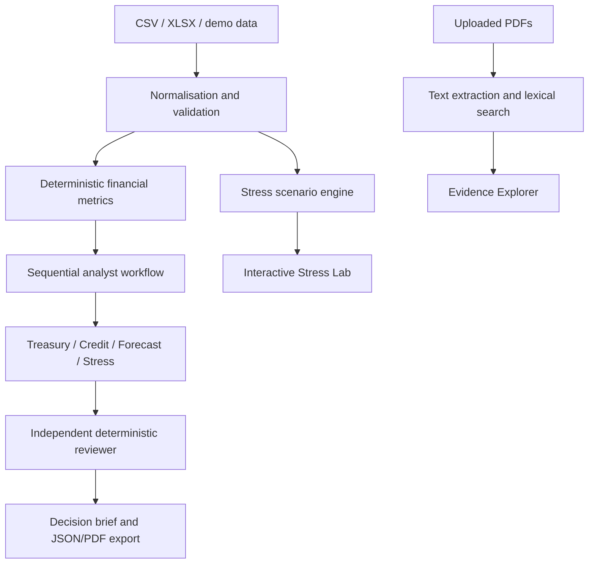

# ARGUS | Enterprise Financial Risk Intelligence

ARGUS is a modular corporate financial risk decision-support application built with Python and Streamlit. It includes deterministic financial metrics, an explicit one-quarter stress model, a bounded sequential agent workflow with an independent reviewer, CSV/XLSX ingestion, keyword search over uploaded PDF text, and PDF/JSON report exports.

> **Data notice:** The bundled company data is entirely synthetic and fictional. It is not sourced from NSE, BSE, RBI, or any real company. User-uploaded information is not independently verified.

## Current capabilities

- Executive dashboard with liquidity and solvency trends.
- Company analysis with financial-ratio definitions and data-quality checks.
- Interactive base/adverse/severe stress presets and custom scenario assumptions.
- Treasury, credit, forecasting, stress, and research-status agents plus deterministic reviewer.
- CSV and XLSX upload for one company with one row per reporting period.
- PDF text extraction and transparent keyword-overlap search with filename/page references.
- PDF and JSON assessment exports.
- Session-level run history and an audit/reproducibility JSON bundle.
- Demo mode without an API key or external service.

## Important limitations

- The current agent workflow is a sequential Python state machine, not LangGraph, and no LLM is called.
- The Research agent in the risk-assessment workflow is still a status/stub agent. The Evidence Explorer separately extracts and searches user-uploaded PDFs, but the retrieved evidence is not yet automatically passed into the workflow's research agent or attached to individual findings.
- PDF search is lexical token overlap, not semantic embedding search. Scanned PDFs without selectable text are not OCR-processed.
- The uploaded financials schema expects one company and consistent reporting frequency/units per run. Sort rows chronologically before analysis.
- Stress results are conditional model estimates, not forecasts. Floating-rate debt share and covenant thresholds are assumptions unless supplied from actual documentation.
- DIO and DPO are labelled proxies because the current schema does not require cost of goods sold.
- History is held in Streamlit session state and is not durable across restarts or shared between users.
- No real-company dataset is bundled. Obtain official company filings from investor-relations pages and exchange sources, and verify the source and licensing before use.

## Requirements

- Python 3.11 recommended.
- No GPU, paid API key, Docker, database server, or external service required for demo mode.

## Run locally

### macOS / Linux

```bash
python3 -m venv .venv
source .venv/bin/activate
python -m pip install --upgrade pip
pip install -r requirements.txt
streamlit run app.py
```

### Windows PowerShell

```powershell
py -3.11 -m venv .venv
.\.venv\Scripts\Activate.ps1
python -m pip install --upgrade pip
pip install -r requirements.txt
streamlit run app.py
```

The app should open in the browser at the local address printed by Streamlit. Select **Demonstration data** in the sidebar to use the fictional bundled dataset, or choose **Upload financials** to load a CSV/XLSX.

## Data upload format

Use one row per period and keep all rows for a run in the same currency, units, company, and period frequency. Recommended columns include:

`company_name, sector, reporting_period, period_type, currency, units, revenue, operating_profit, total_assets, cash_and_equivalents, current_assets, current_liabilities, total_debt, short_term_debt, long_term_debt, operating_cash_flow, capital_expenditure, interest_expense, receivables, inventory, payables`

Missing values should be left blank, not entered as zero. If using Excel, place the column headings in the first row of the first worksheet. Ensure reporting periods are ordered chronologically.

## Run tests

```bash
python -m pytest -q tests
```

The tests cover deterministic financial metrics, input validation, scenario assumptions, workflow contracts, uploaded data normalisation, evidence search, and PDF report generation. A passing unit test suite does not substitute for running and manually checking the Streamlit UI in a clean environment.

## Deploy to Streamlit Community Cloud

1. Create a GitHub repository and upload the contents of this project directory.
2. Open [Streamlit Community Cloud](https://share.streamlit.io/).
3. Create a new app and select the repository, branch, and `app.py` as the main file.
4. Deploy. No secrets are required for demonstration mode.
5. Test the deployed app with demo data before uploading any sensitive files.

The deployment uses ephemeral session storage. Do not expect uploaded data or audit history to persist after a restart. Do not upload confidential company or customer information to a public deployment without a suitable security and privacy review.

## Architecture



## Suggested next extensions

1. Connect retrieved document passages to the Research agent with source-level provenance.
2. Add multiple-company sample datasets and robust fiscal-period parsing.
3. Add persistent storage and per-user access controls only if needed.
4. Compare multi-agent outputs against rules-only and single-agent baselines.
5. Add an optional LLM provider behind a configuration interface, with explicit data-transmission disclosure and structured output validation.

## Disclaimer

ARGUS is an educational and analytical decision-support tool. It is not an audit opinion, calibrated credit rating, investment recommendation, or substitute for professional financial judgement.
